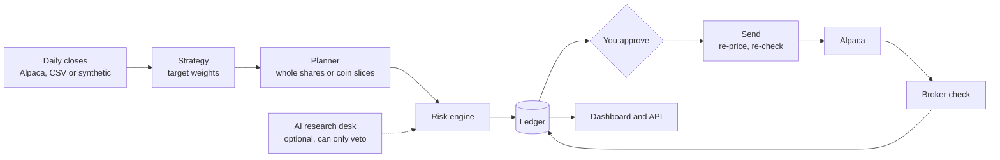
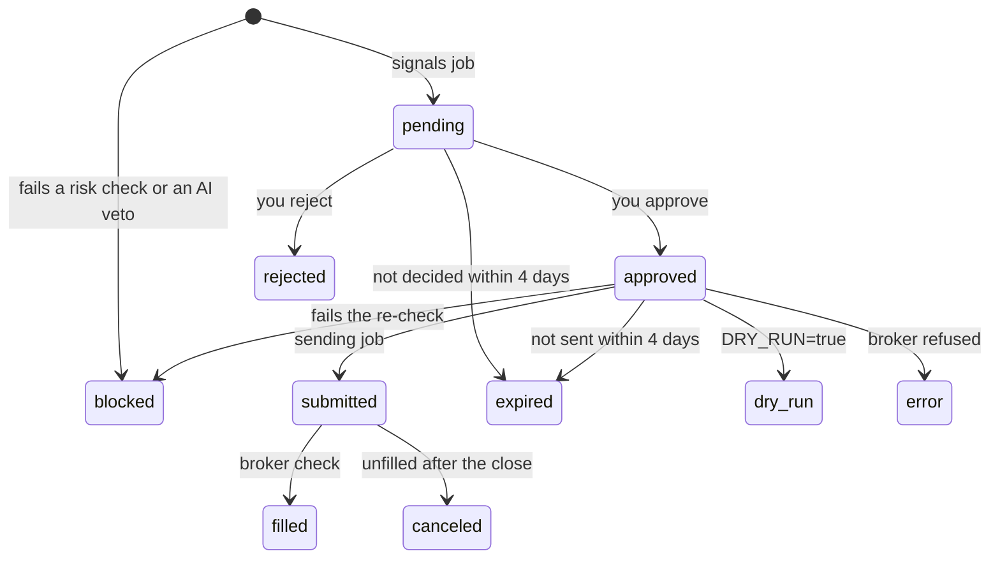

# Architecture

The app is a pipeline with one rule: **AI proposes, code decides.** Anything can suggest a trade. Only the planner, the risk engine and your approval decide what reaches the broker.

## The pieces

All backend code is in `backend/src/trader/`.

| Piece | Where | What it does |
|---|---|---|
| Strategies | `strategies/` | Pure functions from past closes to target weights, one row per day. No I/O. `TrendFollowing` holds every symbol above its 200-day average at equal weight. `Momentum` holds the top 3 by 12-month return, skipping the latest month, and rebalances on the first trading day of each month. |
| Planner | `planner.py` | `plan_intents` turns target weights, prices and the account into orders. The live pipeline and the backtester both call it. |
| Asset rules | `assets.py` | How quantities and prices round: whole shares and cents for stocks; for each crypto pair, Alpaca's smallest order, quantity step and price step; for currency pairs, whole units and prices to 0.00001 (0.001 for the yen, forint and baht, 0.0001 for the koruna; OANDA's figures when live). A symbol with a slash is a pair: two currency codes (`EUR/USD`) make it forex, anything else (`BTC/USD`) crypto. |
| Money | `money.py` | What a position or an order is worth in dollars. Shares, coins and pairs quoted in dollars count qty x price; in a pair with the dollar first (USD/MXN) a unit is one dollar and the profit, in pesos, converts back at the current price. Positions are fully paid for, shorts too: opening one sets aside its dollar size, and it is worth that plus its profit. The planner, risk engine, backtester, brokers and dashboard all count through it. |
| Preferences | `preferences.py` | The dashboard's choices for each book: the stop-loss, and for forex the pair set and short selling. Kept in the book's ledger and applied on top of its settings file; riskier choices return warnings and need confirming. |
| Recommendations | `services/recommendations.py` | The nightly job saves a snapshot (targets, closes, each symbol's reason, why a buy got no order). The API turns it and the live account into Buy, Sell, Hold and Stay out calls, with the latest backtest record and Gate 1 result. |
| Scanner | `services/scanner.py` | Ranks the watchlist by the momentum measure each night. Ideas get an entry, stop and size under the same limits, and are never orders. |
| Learn | `services/learn.py`, `frontend/src/learn/` | Lessons in Markdown, quizzes and the glossary live in the dashboard; progress is saved in the ledger. |
| Risk engine | `risk/` | `check_order` is a pure function from an order, the account and the context to a list of violations. It runs when a proposal is created and again right before sending. |
| Ledger | `db.py`, `ledger.py` | SQLAlchemy 2 tables for signals, proposals, orders, equity, AI decisions, broker checks, app state and an audit log. SQLite by default, Postgres through `DATABASE_URL`. |
| Jobs | `services/` | `pipeline.run_nightly` (signals and proposals), `execution.submit_approved` (sending), `reconcile.reconcile` (broker check), `protect.protect` (crypto stops), plus the kill switch, approvals, replay and the gates. `forex.py` holds the forex clock: the week from Sunday to Friday 5 pm New York, the day's close, the rollover window. |
| Brokers | `broker/` | `AlpacaBroker` wraps `alpaca-py`; with `crypto=True` it trades pairs and sees only crypto positions and orders, and a stock book sees only stocks. `FakeBroker` is an in-memory broker for the demo and the tests, with a crypto mode that has no OTO orders and takes its fee in coins. `OandaBroker` talks to OANDA's v20 REST API over `httpx` for the forex book, and `FakeBroker` has a forex mode too. All of them satisfy the same `Broker` protocol. |
| Prices | `data/` | Alpaca daily bars (split- and dividend-adjusted for stocks; for crypto, finished days only), OANDA's daily mid-price candles for forex (closing at 5 pm New York, finished days only), a CSV file, or deterministic synthetic prices. |
| Backtester | `backtest/` | Daily, event-driven backtests through the same planner, plus metrics, reports and Gate 1. |
| AI research desk | `ai/` | The `AIResearcher` protocol, a null researcher, and an optional TradingAgents adapter. |
| Notifications | `notify/` | Telegram messages with Approve and Reject buttons, and a poller for the button presses. |
| Scheduler | `scheduler.py` | APScheduler inside the API process. Stocks, on weekdays in New York time: signals at 5:15 pm, sending at 9:50 am, the broker check at 4:30 pm. Crypto, every day: the broker check at 12:05 am and signals at 12:15 am Chicago time, sending and protecting every 5 minutes. Forex, on weekdays in New York time: sending at 9:50 am, the broker check at 5:05 pm, signals at 5:15 pm. |
| API | `api/` | FastAPI routes for the dashboard, with an optional bearer token. A crypto book runs beside the stock book under `/api/crypto` and a forex book under `/api/forex`, behind the same token, and `/api/books` lists them all. It also serves the built dashboard. |
| Command line | `cli.py` | The `trader` command. |

The dashboard in `frontend/` is React and Vite, with no state library. It polls the API every 30 seconds and whenever the tab becomes visible again.

## Books

A book is one account with its own settings, ledger and schedule. `ASSET_CLASS` picks what it trades. The stock book is the default; `ASSET_CLASS=crypto` and `ASSET_CLASS=forex` make crypto and forex books with their own starting values (`CRYPTO_DEFAULTS` and `FOREX_DEFAULTS` in `config.py`). `CRYPTO_ENV_FILE` and `FOREX_ENV_FILE` run them beside the stock book in the same process; each reads only its own file, so the stock book's environment never leaks in. The demo always gets both, on made-up prices. Every book shares the planner, the risk engine, approvals, the ledger code and the dashboard; the dashboard shows each as a tab. Settings refuse a book on the wrong broker: stocks and crypto use Alpaca, forex uses OANDA.

What differs for crypto, and where:

- **Clock.** Crypto trades around the clock. Alpaca's daily crypto bars run from midnight to midnight Chicago time, so the book works from finished days (`AppContext.bar_date`) and runs its daily jobs just after midnight Chicago time. Sending needs no trading window.
- **Sizes.** Quantities are slices of a coin, rounded down to each pair's step (`assets.py`), with prices on the pair's tick.
- **Stops.** Alpaca takes no OTO orders for crypto, so entries are plain GTC limits and `protect.protect` puts a GTC stop-limit sell under each new position as soon as it fills (sending calls it straight away; the scheduler every 5 minutes). It also replaces a stop that covers less than the position, cancels orders unfilled after `ENTRY_TTL_MINUTES`, sells at once if the price is already below the stop, and warns once when a price is below a stop's limit, where the stop can't fill.
- **Risk.** A stop-limit fills no lower than its limit, so the risk engine and the planner count the worst fill: the stop, less `STOP_LIMIT_BAND_PCT`. With a 15% stop and a 5% band that is 19.25% below the entry, which caps each coin at about 5% of equity under the 1% risk limit.
- **Fees.** Alpaca takes its crypto fee from the asset received, so a buy credits slightly fewer coins than ordered. Stops are sized from the coins held, and leftovers too small to sell (dust) are ignored.

What differs for forex, and where:

- **Broker.** Alpaca has no currency trading, so the forex book runs at OANDA (`broker/oanda_broker.py`, plain HTTPS with a bearer token; practice server on paper, live server on live). Pairs are `EUR/USD` in the app and `EUR_USD` at OANDA. Every pair needs the dollar on one side, so every size, stop and loss is in the account's currency (`money.py` converts pairs with the dollar first); crosses like EUR/GBP are refused.
- **Pair sets.** `PAIR_SET` picks the pairs and their risk settings together (`PAIR_SETS` in `config.py`): `standard`, the seven majors at up to 14% each with a 3% stop, or `exotic`, the dollar against six emerging-market currencies at up to 10% each with a 5% stop and higher backtest costs. Values set in the file win over the set; a set picked on the dashboard wins over both.
- **Clock.** The week runs from Sunday 5 pm to Friday 5 pm New York time, and each day ends at 5 pm (`forex.bar_date`): the session that opens Sunday evening is Monday's. Sending checks OANDA's tradeable flag (holidays) and waits out 4:45 to 5:15 pm, when spreads widen.
- **Orders.** Entries are GTC limit orders with `stopLossOnFill` and `positionFill: OPEN_ONLY`: a buy, or for a short a sell (negative units); OANDA hangs the stop-loss on the new trade, below a long and above a short, like a stock OTO. Exits are `REDUCE_ONLY` limit orders on the other side, so they can never open a position. Closing a trade cancels its stop, so unlike stocks the app exits without canceling the stop first. The broker check at 5:05 pm cancels any entry or exit still waiting; the stops stay. OANDA reports a stop-loss with no pair or size of its own, so the adapter joins it to its trade and gives it the trade's opposite side.
- **Short selling.** Off unless `ALLOW_SHORTS` (or the dashboard) switches it on. `TrendFollowing(shorts=True)` targets -1/N for a pair below its average; the planner turns that into a sell entry with its stop above, and a buy exit (a cover) when the target returns to zero. A position whose target changes side is closed first and the new side opens on a later day. The risk engine refuses a short entry while shorting is off, checks a short's stop sits above its limit, measures its loss at the stop in dollars, refuses an entry against an open position on the other side, and refuses any exit larger than the position it closes. The broker check wants a buy stop over each short. Client order IDs end in `-short` and `-cover`.
- **No leverage.** `get_account` reports buying power as NAV minus the value of open positions and pending entries (long or short), so the margin OANDA would lend is never used. OANDA doesn't report yesterday's equity, so the day's P&L starts from the equity the last broker check recorded.
- **Financing.** Positions open at 5 pm New York pay or earn the interest gap between the two currencies. Backtests charge `FINANCING_BPS_PER_YEAR` (250 for the standard pairs, 600 for the exotic ones) on what's held, long or short, for every night, three over a weekend; the fake broker charges it in the demo too.
- **Signals.** Each daily run replaces the last: proposals from an earlier day that were never sent expire.

## Planning rules

- Orders are whole entries or whole exits. There are no trims or top-ups, so the live account and the backtest can't drift apart through small rebalances.
- Stocks trade in whole shares; crypto in slices rounded down to the pair's step; forex in whole units of the first currency.
- Exits are planned first, and their proceeds count as cash for that day's entries.
- An entry's size is its target weight or the largest entry the limits allow, whichever is smaller, times equity. The largest entry is the smaller of 10% of equity and the risk per trade divided by the stop distance (1% / 8% = 12.5%). Cash and the open-position cap also limit it.
- Buy limits sit 0.2% above the last price, rounded up to the cent. The stop sits 8% below the limit. Crypto: 0.5% above, a 15% stop, and its limit 5% below the stop. Forex: 0.1% above (0.3% for the exotic pairs), rounded up to the pair's step, and a 3% stop (5% exotic). A forex short mirrors it: its limit sits below the price and its stop above, each rounded toward less risk.
- Sizes are in dollars (`money.py`), and an entry also shrinks if its loss at the stop, counted in dollars, would pass the risk per trade. That only bites for a pair with the dollar first, whose loss at the stop's price comes to a little more than the stop distance.
- The dashboard's choices (`preferences.py`) feed the same settings: a new stop, pair set or short-selling switch changes the next plan, expires proposals still waiting, and leaves open positions with the stops they have.
- Positions outside the strategy's universe are never touched. The broker check flags them instead.

## Order lifecycle

**Entries** go out as one-triggers-other orders: a GTC limit buy with a stop-loss leg. The stop exists at Alpaca the moment the buy fills, so it protects the position even if this app is off. Both legs are GTC so the stop survives past the first day. The broker check after the close cancels any entry that hasn't filled, so an entry never lingers. Crypto entries are plain GTC limits; the stop-limit follows the fill (Two books, above), and unfilled entries are canceled after an hour.

**Exits** first cancel the symbol's open stop (Alpaca rejects a sell for shares already held by another order), then go out as a day limit sell.

**Sending** re-prices each approved order at the latest trade, skips entries whose price has risen more than 2% above the close they were sized on, re-sizes to the current account, and runs the risk checks again. It only sends inside the trading window: from 15 minutes after the open to 15 minutes before the close.

**The kill switch** is a flag in the ledger. Engaging it cancels every open order except protective stops, and the risk engine then rejects every new order. The broker check engages it on its own when equity falls 10% below its peak. Releasing it is always a deliberate step.

**Client order IDs** are built from the account, date, symbol and side, for example `tpA-20261113-SPY-buy`; a pair drops its slash (`tpC-20261113-BTCUSD-buy`, `tpF-20261113-EURUSD-buy`), a forex short and its cover end in `-short` and `-cover`, and a stop adds `-stop`. Alpaca rejects a second order with the same ID, and the broker check flags any order with this app's prefix that the ledger doesn't know.

## Parity: the backtest trades like the app

The backtester steps through daily closes. Each day it marks positions to the close, fires stops whose level the close has reached (with no re-entry that day), asks `plan_intents` for the day's orders, and fills them at the close plus `cost_bps`.

- With `lag=1` a signal trades at the close it was computed on, which is slightly optimistic.
- With `lag=2` it trades a day later, which is pessimistic.

Live orders fill the next morning, in between the two, so Gate 1 requires a strategy to survive both. The backtester doesn't apply the daily-loss pause or the drawdown kill switch. Its report counts how often they would have fired.

For crypto the same engine runs on a seven-day calendar (metrics annualize over 365 days when the dates include weekends) and charges `COST_BPS=35` per side for the fee and spread. It fills stops at the close that reached them, which is kinder than a real stop-limit, which can stay unfilled when the price falls straight through its limit. For forex it runs on weekdays, charges `COST_BPS` per side (3 standard, 15 exotic) and the nightly financing, holds shorts when they're switched on (stops fire when the close reaches them from below), and counts every pair in dollars; the benchmark line pays no financing.

`tests/test_parity.py` checks this in two ways. The live pipeline's signals must equal the backtest's weights on the same data. And replaying the real jobs day by day against the fake broker must produce the same trades as a `lag=2` backtest.

## Choices worth knowing

- **Our own backtester instead of vectorbt.** The game plan named vectorbt. A backtester built on the live planner gives exact parity with what the app will trade. A daily simulation of ten ETFs is cheap anyway. vectorbt's open-source licence also adds the Commons Clause, which restricts selling software built on it.
- **No take-profit leg.** These strategies exit when the signal says so. A fixed take-profit would cut winners short, so entries carry only a stop (one-triggers-other rather than a full bracket).
- **Whole shares.** Alpaca takes fractional quantities only on day orders, and entries here are GTC so their stop leg lasts. Whole shares also keep the backtest and the live account identical. Crypto is the exception: Alpaca's crypto orders are GTC and fractional, and the backtest sizes coins the same way.
- **Prices.** Historical bars use the SIP feed. On Alpaca's free plan that works for data older than 15 minutes, and daily bars only need the close. The latest price for sending uses the free IEX feed.
- **Time.** The schedule, signal dates and the trading window are New York time; the crypto day follows Alpaca's bars, midnight to midnight Chicago time; the forex day ends at 5 pm New York. The database stores UTC.
- **One database per account.** The first time a database is opened, it records its mode (demo, paper or live) and account label. Opening it with different settings fails, so a demo or paper record can never land in a live ledger.

## Extending it

- **A new strategy.** Subclass `Strategy` in `strategies/`. Implement `lookback_days`, `target_weights` (each row may use only closes up to that row), `params` and `variants` (the parameters moved about 20% each way, for Gate 1), then register it in `STRATEGIES`. Give it a `rule_text`, an `explain` that says in plain words why each symbol is in or out, and a `lesson`, so its recommendations explain themselves. Copy the look-ahead test in `tests/test_strategies.py`.
- **A new lesson.** Add a Markdown file to `frontend/src/learn/lessons/` and list it in `frontend/src/learn/course.ts`.
- **A new broker.** Implement the `Broker` protocol in `broker/base.py` and add it to `get_broker`.
- **More coins.** Add pairs to the crypto book's `UNIVERSE` (for example `SOL/USD`); the live app reads each pair's order sizes from Alpaca. Keep the per-coin cap small: coins tend to fall together.
- **Pairs not quoted in dollars.** USD/JPY or EUR/GBP would need every size and loss converted to dollars first, so the settings refuse them until that exists. Keep the open-position cap either way: pairs against the dollar tend to move together.
- **A new AI researcher.** Implement `AIResearcher.review(symbol, as_of)` so it returns an `AIDecision`, and add it to `get_researcher`. In veto mode, the ratings in `AI_VETO_RATINGS` block an entry. The researcher can never create an order.
